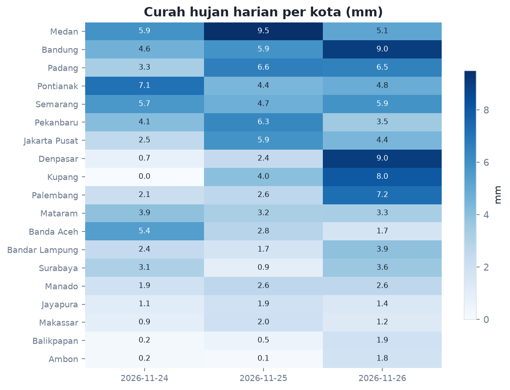

# Prakiraan Cuaca Indonesia

Analisis 19 kota, 391 slot prakiraan 3 jam (27 Nov 2026 sampai 29 Nov 2026). Sumber: API prakiraan cuaca BMKG. Dibuat 2026-11-27 03:40 UTC.

## Angka kunci

- Paling basah: **Padang** dengan 43.1 mm dalam 63 jam.
- Paling kering: **Denpasar** dengan 0.6 mm.
- Suhu tertinggi: **Kupang** 34 C.
- Suhu terendah: **Bandung** 20 C.
- Rentang suhu antar kota: 14.0 C (selisih harian rata-rata 5.9 C).
- Kota tanpa hujan sama sekali: 0 dari 19.

## Ringkasan per kota

| Kota | Hujan 63 jam (mm) | Jam hujan | Slot lebat | Suhu (C) | RH (%) | Angin maks (km/jam) | Kondisi dominan |
|---|---|---|---|---|---|---|---|
| Padang | 43.1 | 63 | 0 | 24-26 | 89 | 8.2 | Hujan Ringan |
| Palembang | 29.1 | 60 | 0 | 25-30 | 90 | 8.1 | Berawan |
| Bandung | 28.7 | 42 | 0 | 20-25 | 90 | 6.7 | Berawan |
| Medan | 22.9 | 63 | 0 | 24-29 | 92 | 9.1 | Berawan |
| Pekanbaru | 20.0 | 63 | 0 | 24-30 | 92 | 7.0 | Berawan |
| Bandar Lampung | 19.8 | 60 | 0 | 24-30 | 90 | 13.6 | Berawan |
| Pontianak | 18.5 | 57 | 0 | 24-30 | 93 | 10.4 | Berawan |
| Jakarta Pusat | 14.0 | 57 | 0 | 24-30 | 86 | 9.3 | Berawan |
| Mataram | 11.4 | 39 | 0 | 24-32 | 90 | 24.7 | Berawan |
| Surabaya | 10.3 | 54 | 0 | 24-33 | 84 | 29.5 | Berawan |
| Semarang | 8.8 | 39 | 0 | 25-33 | 84 | 10.7 | Berawan |
| Makassar | 6.7 | 27 | 0 | 26-30 | 84 | 8.9 | Berawan |
| Banda Aceh | 6.4 | 48 | 0 | 24-30 | 87 | 15.4 | Berawan |
| Kupang | 5.4 | 30 | 0 | 26-34 | 79 | 10.1 | Cerah |
| Balikpapan | 5.0 | 39 | 0 | 25-30 | 85 | 14.5 | Berawan |
| Jayapura | 4.9 | 48 | 0 | 24-28 | 89 | 15.1 | Cerah Berawan |
| Manado | 3.7 | 15 | 0 | 24-30 | 82 | 7.9 | Cerah |
| Ambon | 3.4 | 15 | 0 | 24-32 | 86 | 10.4 | Cerah |
| Denpasar | 0.6 | 3 | 0 | 25-31 | 85 | 19.4 | Berawan |

## Kondisi yang diprediksi

| Kondisi | Slot | Porsi (%) | Jumlah kota |
|---|---|---|---|
| Berawan | 164 | 41.9 | 19 |
| Hujan Ringan | 84 | 21.5 | 17 |
| Cerah | 64 | 16.4 | 13 |
| Cerah Berawan | 59 | 15.1 | 15 |
| Udara Kabur | 14 | 3.6 | 5 |
| Hujan Petir | 5 | 1.3 | 4 |
| Hujan Sedang | 1 | 0.3 | 1 |

## Peringatan dini

Slot yang melewati ambang hujan lebat (>= 20 mm/3 jam), angin kencang (>= 30 km/jam), atau suhu ekstrem (>= 34 C):

- **Kupang** 28 Nov 12:00: suhu 34 C (Hujan Petir)
- **Kupang** 29 Nov 12:00: suhu 34 C (Cerah)

## Gambar

## Catatan metode

- Setiap slot mewakili 3 jam. `jam_hujan` = jumlah slot dengan curah hujan > 0 dikali 3.
- Suhu terasa memakai apparent temperature Steadman: `AT = Ta + 0.33e - 0.70ws - 4.00`, dengan `e` tekanan uap air dari suhu dan kelembapan.
- Kategori hujan per slot: kering (< 0,1 mm), ringan (< 5 mm), sedang (< 20 mm), lebat (< 50 mm), sangat lebat.
- Prakiraan BMKG adalah keluaran model, bukan observasi. Angka bisa berubah setiap kali pipeline dijalankan.
