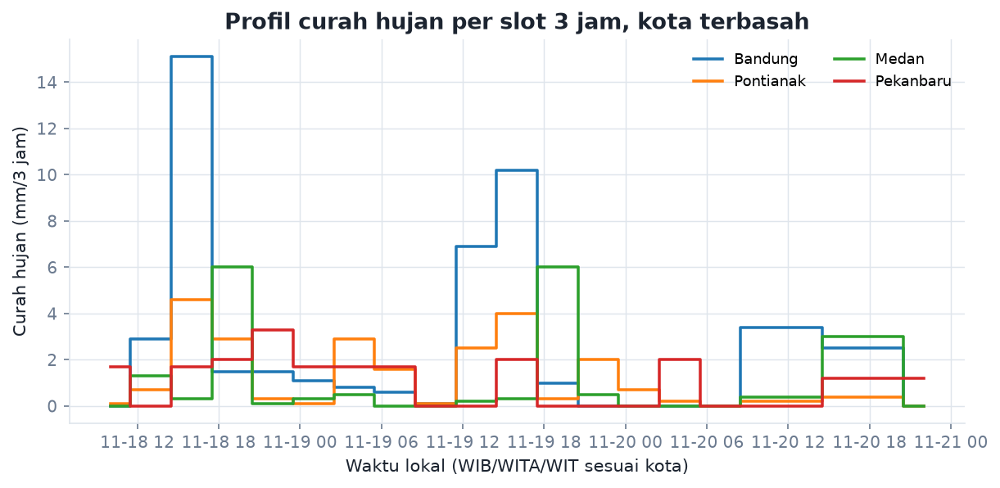

# Prakiraan Cuaca Indonesia

Analisis 19 kota, 400 slot prakiraan 3 jam (23 Nov 2026 sampai 25 Nov 2026). Sumber: API prakiraan cuaca BMKG. Dibuat 2026-11-23 01:49 UTC.

## Angka kunci

- Paling basah: **Bandung** dengan 26.6 mm dalam 63 jam.
- Paling kering: **Ambon** dengan 0.6 mm.
- Suhu tertinggi: **Surabaya** 35 C.
- Suhu terendah: **Bandung** 20 C.
- Rentang suhu antar kota: 15.0 C (selisih harian rata-rata 6.2 C).
- Kota tanpa hujan sama sekali: 0 dari 19.

## Ringkasan per kota

| Kota | Hujan 63 jam (mm) | Jam hujan | Slot lebat | Suhu (C) | RH (%) | Angin maks (km/jam) | Kondisi dominan |
|---|---|---|---|---|---|---|---|
| Bandung | 26.6 | 51 | 0 | 20-28 | 87 | 6.2 | Berawan |
| Medan | 25.5 | 51 | 0 | 23-30 | 91 | 9.8 | Hujan Ringan |
| Semarang | 23.6 | 42 | 0 | 26-32 | 83 | 9.0 | Berawan |
| Jakarta Pusat | 17.5 | 57 | 0 | 25-31 | 85 | 6.7 | Hujan Ringan |
| Pontianak | 16.3 | 48 | 0 | 24-31 | 91 | 10.2 | Cerah Berawan |
| Palembang | 15.3 | 42 | 0 | 24-31 | 89 | 5.6 | Berawan |
| Mataram | 13.4 | 51 | 0 | 24-32 | 84 | 27.2 | Cerah Berawan |
| Bandar Lampung | 11.7 | 51 | 0 | 24-29 | 89 | 13.4 | Berawan |
| Surabaya | 10.6 | 30 | 0 | 25-35 | 78 | 18.5 | Hujan Ringan |
| Padang | 9.7 | 54 | 0 | 26-28 | 86 | 8.1 | Berawan |
| Kupang | 8.2 | 27 | 0 | 25-35 | 77 | 15.0 | Cerah |
| Banda Aceh | 7.9 | 51 | 0 | 24-29 | 87 | 14.3 | Berawan |
| Denpasar | 7.0 | 51 | 0 | 26-32 | 82 | 14.3 | Cerah Berawan |
| Manado | 5.6 | 39 | 0 | 25-30 | 84 | 8.4 | Cerah Berawan |
| Jayapura | 5.3 | 27 | 0 | 24-29 | 89 | 20.8 | Cerah Berawan |
| Pekanbaru | 4.1 | 18 | 0 | 24-30 | 90 | 7.0 | Cerah Berawan |
| Balikpapan | 3.9 | 36 | 0 | 25-30 | 83 | 12.3 | Berawan |
| Makassar | 3.2 | 33 | 0 | 26-30 | 81 | 10.9 | Berawan |
| Ambon | 0.6 | 15 | 0 | 24-30 | 82 | 11.1 | Berawan |

## Kondisi yang diprediksi

| Kondisi | Slot | Porsi (%) | Jumlah kota |
|---|---|---|---|
| Berawan | 134 | 33.5 | 17 |
| Cerah Berawan | 131 | 32.8 | 19 |
| Hujan Ringan | 71 | 17.8 | 16 |
| Cerah | 51 | 12.8 | 13 |
| Udara Kabur | 11 | 2.8 | 4 |
| Hujan Petir | 1 | 0.2 | 1 |
| Hujan Sedang | 1 | 0.2 | 1 |

## Peringatan dini

Slot yang melewati ambang hujan lebat (>= 20 mm/3 jam), angin kencang (>= 30 km/jam), atau suhu ekstrem (>= 34 C):

- **Surabaya** 23 Nov 12:00: suhu 35 C (Cerah)
- **Surabaya** 23 Nov 15:00: suhu 34 C (Cerah Berawan)
- **Kupang** 24 Nov 13:00: suhu 35 C (Hujan Petir)
- **Kupang** 23 Nov 13:00: suhu 35 C (Cerah)
- **Surabaya** 23 Nov 09:00: suhu 34 C (Cerah Berawan)

## Gambar

## Catatan metode

- Setiap slot mewakili 3 jam. `jam_hujan` = jumlah slot dengan curah hujan > 0 dikali 3.
- Suhu terasa memakai apparent temperature Steadman: `AT = Ta + 0.33e - 0.70ws - 4.00`, dengan `e` tekanan uap air dari suhu dan kelembapan.
- Kategori hujan per slot: kering (< 0,1 mm), ringan (< 5 mm), sedang (< 20 mm), lebat (< 50 mm), sangat lebat.
- Prakiraan BMKG adalah keluaran model, bukan observasi. Angka bisa berubah setiap kali pipeline dijalankan.
