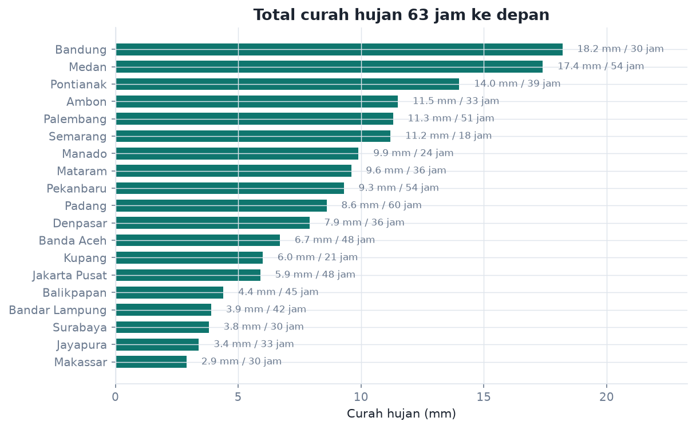
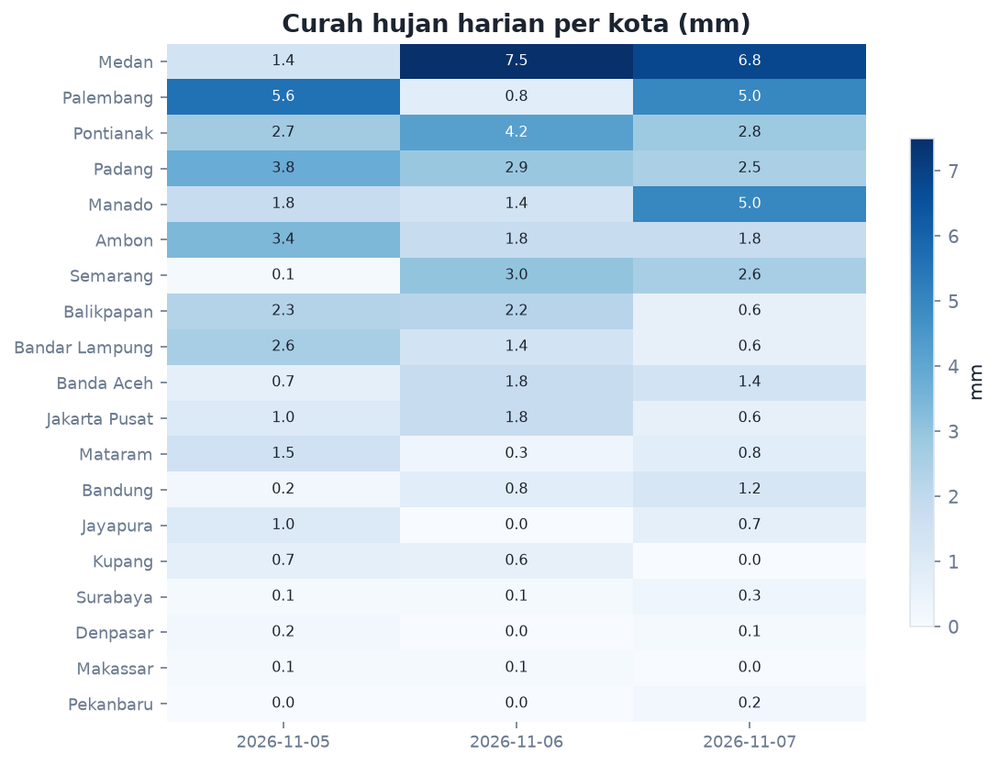
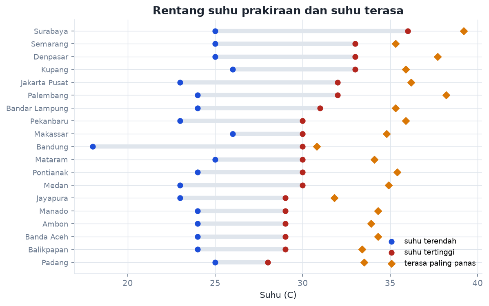
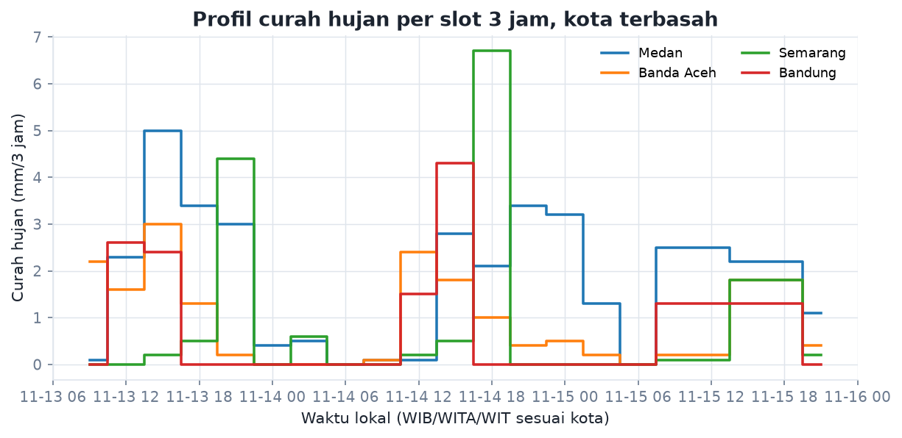

# Prakiraan Cuaca Indonesia

Analisis 19 kota, 413 slot prakiraan 3 jam (2 Nov 2026 sampai 4 Nov 2026). Sumber: API prakiraan cuaca BMKG. Dibuat 2026-11-02 00:51 UTC.

## Angka kunci

- Paling basah: **Bandar Lampung** dengan 12.4 mm dalam 66 jam.
- Paling kering: **Kupang** dengan 0.3 mm.
- Suhu tertinggi: **Surabaya** 35 C.
- Suhu terendah: **Bandung** 19 C.
- Rentang suhu antar kota: 16.0 C (selisih harian rata-rata 7.3 C).
- Kota tanpa hujan sama sekali: 0 dari 19.

## Ringkasan per kota

| Kota | Hujan 66 jam (mm) | Jam hujan | Slot lebat | Suhu (C) | RH (%) | Angin maks (km/jam) | Kondisi dominan |
|---|---|---|---|---|---|---|---|
| Bandar Lampung | 12.4 | 51 | 0 | 23-32 | 85 | 10.1 | Udara Kabur |
| Ambon | 10.7 | 30 | 0 | 24-29 | 87 | 13.8 | Udara Kabur |
| Padang | 10.2 | 39 | 0 | 25-28 | 85 | 7.9 | Berawan |
| Palembang | 8.5 | 39 | 0 | 24-31 | 88 | 13.2 | Berawan |
| Pontianak | 7.7 | 45 | 0 | 23-32 | 90 | 11.0 | Cerah Berawan |
| Manado | 7.3 | 30 | 0 | 24-30 | 83 | 9.0 | Cerah |
| Medan | 6.7 | 51 | 0 | 23-31 | 89 | 7.9 | Berawan |
| Denpasar | 6.7 | 30 | 0 | 25-32 | 85 | 16.6 | Cerah |
| Pekanbaru | 5.7 | 27 | 0 | 23-31 | 88 | 8.2 | Berawan |
| Bandung | 5.5 | 33 | 0 | 19-30 | 78 | 9.9 | Cerah |
| Mataram | 4.9 | 36 | 0 | 25-31 | 81 | 19.8 | Cerah |
| Semarang | 4.6 | 36 | 0 | 25-34 | 73 | 16.6 | Cerah |
| Banda Aceh | 3.9 | 36 | 0 | 24-30 | 86 | 10.8 | Berawan |
| Balikpapan | 3.6 | 42 | 0 | 24-30 | 82 | 13.3 | Cerah |
| Jakarta Pusat | 3.0 | 36 | 0 | 25-31 | 79 | 9.1 | Cerah |
| Jayapura | 1.8 | 33 | 0 | 23-28 | 82 | 12.0 | Cerah Berawan |
| Surabaya | 1.6 | 21 | 0 | 24-35 | 68 | 16.7 | Cerah |
| Makassar | 1.4 | 15 | 0 | 26-31 | 76 | 17.2 | Cerah |
| Kupang | 0.3 | 3 | 0 | 20-32 | 70 | 10.9 | Cerah |

## Kondisi yang diprediksi

| Kondisi | Slot | Porsi (%) | Jumlah kota |
|---|---|---|---|
| Cerah | 189 | 45.8 | 18 |
| Berawan | 82 | 19.9 | 15 |
| Cerah Berawan | 76 | 18.4 | 17 |
| Udara Kabur | 33 | 8.0 | 7 |
| Hujan Ringan | 32 | 7.7 | 13 |
| Kabut/Asap | 1 | 0.2 | 1 |

## Peringatan dini

Slot yang melewati ambang hujan lebat (>= 20 mm/3 jam), angin kencang (>= 30 km/jam), atau suhu ekstrem (>= 34 C):

- **Surabaya** 03 Nov 13:00: suhu 34 C (Cerah)
- **Semarang** 03 Nov 13:00: suhu 34 C (Cerah)
- **Surabaya** 04 Nov 13:00: suhu 35 C (Cerah)
- **Semarang** 04 Nov 13:00: suhu 34 C (Cerah)
- **Semarang** 02 Nov 13:00: suhu 34 C (Cerah)

## Gambar

## Catatan metode

- Setiap slot mewakili 3 jam. `jam_hujan` = jumlah slot dengan curah hujan > 0 dikali 3.
- Suhu terasa memakai apparent temperature Steadman: `AT = Ta + 0.33e - 0.70ws - 4.00`, dengan `e` tekanan uap air dari suhu dan kelembapan.
- Kategori hujan per slot: kering (< 0,1 mm), ringan (< 5 mm), sedang (< 20 mm), lebat (< 50 mm), sangat lebat.
- Prakiraan BMKG adalah keluaran model, bukan observasi. Angka bisa berubah setiap kali pipeline dijalankan.
