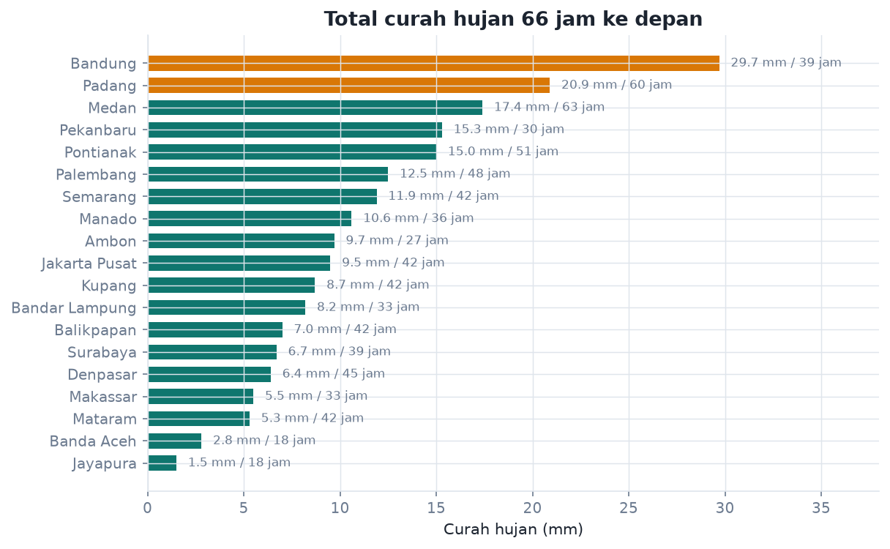
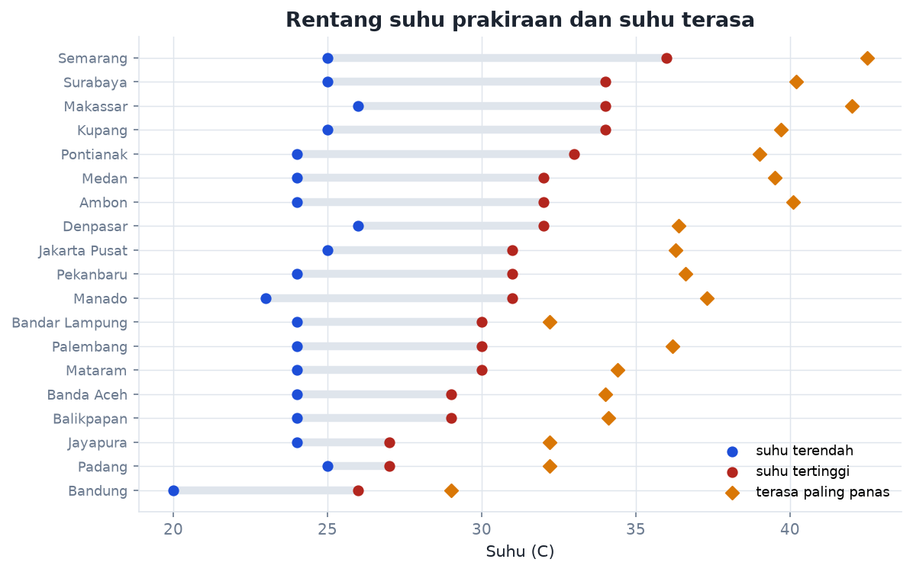

# Prakiraan Cuaca Indonesia

Analisis 19 kota, 379 slot prakiraan 3 jam (24 Nov 2026 sampai 26 Nov 2026). Sumber: API prakiraan cuaca BMKG. Dibuat 2026-11-24 05:22 UTC.

## Angka kunci

- Paling basah: **Medan** dengan 20.5 mm dalam 60 jam.
- Paling kering: **Ambon** dengan 2.1 mm.
- Suhu tertinggi: **Surabaya** 34 C.
- Suhu terendah: **Bandung** 20 C.
- Rentang suhu antar kota: 14.0 C (selisih harian rata-rata 6.2 C).
- Kota tanpa hujan sama sekali: 0 dari 19.

## Ringkasan per kota

| Kota | Hujan 60 jam (mm) | Jam hujan | Slot lebat | Suhu (C) | RH (%) | Angin maks (km/jam) | Kondisi dominan |
|---|---|---|---|---|---|---|---|
| Medan | 20.5 | 48 | 0 | 24-29 | 93 | 10.6 | Berawan |
| Bandung | 19.5 | 24 | 0 | 20-30 | 91 | 7.2 | Berawan |
| Padang | 16.4 | 54 | 0 | 25-28 | 87 | 8.9 | Hujan Ringan |
| Pontianak | 16.3 | 60 | 0 | 24-33 | 92 | 10.8 | Berawan |
| Semarang | 16.3 | 54 | 0 | 26-29 | 84 | 11.9 | Berawan |
| Pekanbaru | 13.9 | 51 | 0 | 24-31 | 90 | 6.4 | Berawan |
| Jakarta Pusat | 12.8 | 45 | 0 | 25-32 | 85 | 7.5 | Berawan |
| Denpasar | 12.1 | 51 | 0 | 25-31 | 82 | 12.5 | Cerah Berawan |
| Kupang | 12.0 | 15 | 0 | 25-33 | 84 | 27.8 | Cerah |
| Palembang | 11.9 | 54 | 0 | 24-31 | 89 | 10.6 | Berawan |
| Mataram | 10.4 | 54 | 0 | 25-31 | 87 | 10.8 | Berawan |
| Banda Aceh | 9.9 | 51 | 0 | 24-28 | 89 | 11.0 | Berawan |
| Bandar Lampung | 8.0 | 39 | 0 | 24-29 | 87 | 15.3 | Cerah Berawan |
| Surabaya | 7.6 | 30 | 0 | 25-34 | 83 | 29.0 | Berawan |
| Manado | 7.1 | 30 | 0 | 25-29 | 86 | 9.3 | Cerah Berawan |
| Jayapura | 4.4 | 54 | 0 | 24-28 | 88 | 19.3 | Berawan |
| Makassar | 4.1 | 42 | 0 | 26-29 | 83 | 10.3 | Berawan |
| Balikpapan | 2.6 | 24 | 0 | 25-32 | 84 | 12.4 | Berawan |
| Ambon | 2.1 | 18 | 0 | 23-34 | 84 | 12.5 | Cerah Berawan |

## Kondisi yang diprediksi

| Kondisi | Slot | Porsi (%) | Jumlah kota |
|---|---|---|---|
| Berawan | 149 | 39.3 | 17 |
| Cerah Berawan | 92 | 24.3 | 18 |
| Hujan Ringan | 78 | 20.6 | 15 |
| Cerah | 40 | 10.6 | 11 |
| Udara Kabur | 19 | 5.0 | 7 |
| Hujan Sedang | 1 | 0.3 | 1 |

## Peringatan dini

Slot yang melewati ambang hujan lebat (>= 20 mm/3 jam), angin kencang (>= 30 km/jam), atau suhu ekstrem (>= 34 C):

- **Surabaya** 25 Nov 12:00: suhu 34 C (Berawan)
- **Ambon** 25 Nov 14:00: suhu 34 C (Cerah)
- **Surabaya** 26 Nov 09:00: suhu 34 C (Cerah Berawan)

## Gambar

## Catatan metode

- Setiap slot mewakili 3 jam. `jam_hujan` = jumlah slot dengan curah hujan > 0 dikali 3.
- Suhu terasa memakai apparent temperature Steadman: `AT = Ta + 0.33e - 0.70ws - 4.00`, dengan `e` tekanan uap air dari suhu dan kelembapan.
- Kategori hujan per slot: kering (< 0,1 mm), ringan (< 5 mm), sedang (< 20 mm), lebat (< 50 mm), sangat lebat.
- Prakiraan BMKG adalah keluaran model, bukan observasi. Angka bisa berubah setiap kali pipeline dijalankan.
