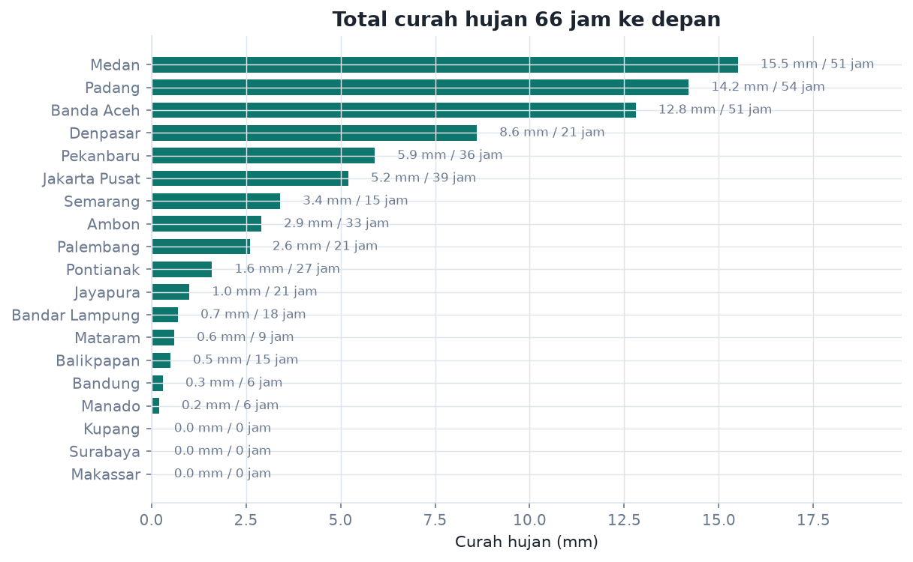
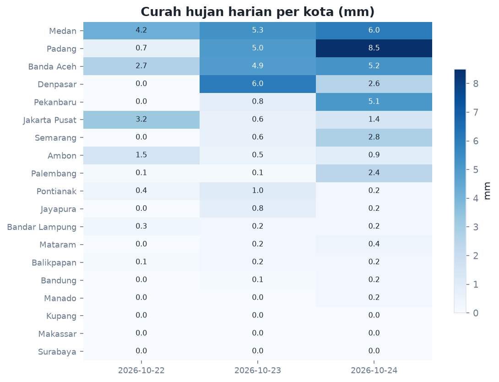
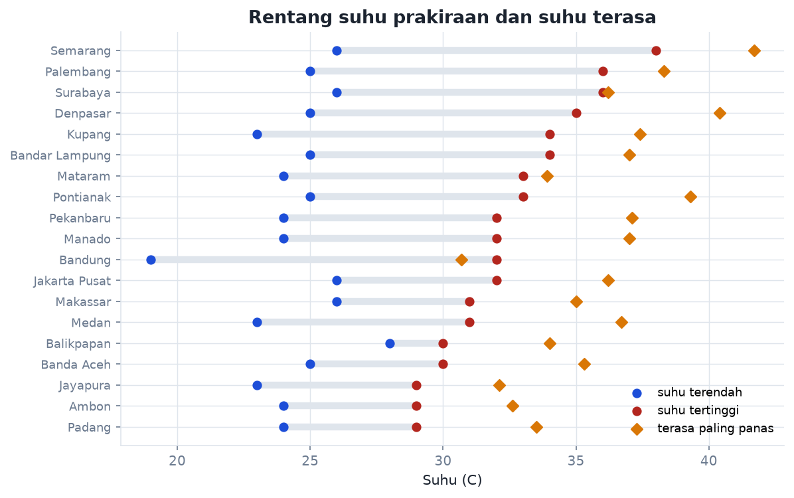
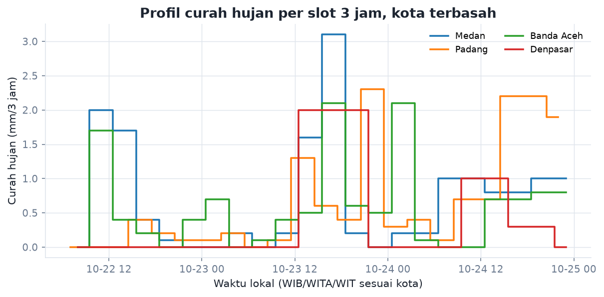

# Prakiraan Cuaca Indonesia

Analisis 19 kota, 414 slot prakiraan 3 jam (22 Okt 2026 sampai 24 Okt 2026). Sumber: API prakiraan cuaca BMKG. Dibuat 2026-10-22 00:03 UTC.

## Angka kunci

- Paling basah: **Medan** dengan 15.5 mm dalam 66 jam.
- Paling kering: **Surabaya** dengan 0.0 mm.
- Suhu tertinggi: **Semarang** 38 C.
- Suhu terendah: **Bandung** 19 C.
- Rentang suhu antar kota: 19.0 C (selisih harian rata-rata 7.9 C).
- Kota tanpa hujan sama sekali: 3 dari 19.

## Ringkasan per kota

| Kota | Hujan 66 jam (mm) | Jam hujan | Slot lebat | Suhu (C) | RH (%) | Angin maks (km/jam) | Kondisi dominan |
|---|---|---|---|---|---|---|---|
| Medan | 15.5 | 51 | 0 | 23-31 | 90 | 8.3 | Berawan |
| Padang | 14.2 | 54 | 0 | 24-29 | 86 | 9.2 | Udara Kabur |
| Banda Aceh | 12.8 | 51 | 0 | 25-30 | 86 | 13.7 | Berawan |
| Denpasar | 8.6 | 21 | 0 | 25-35 | 79 | 18.9 | Cerah Berawan |
| Pekanbaru | 5.9 | 36 | 0 | 24-32 | 86 | 7.4 | Udara Kabur |
| Jakarta Pusat | 5.2 | 39 | 0 | 26-32 | 75 | 13.2 | Cerah |
| Semarang | 3.4 | 15 | 0 | 26-38 | 61 | 13.6 | Cerah |
| Ambon | 2.9 | 33 | 0 | 24-29 | 84 | 13.1 | Udara Kabur |
| Palembang | 2.6 | 21 | 0 | 25-36 | 65 | 15.4 | Udara Kabur |
| Pontianak | 1.6 | 27 | 0 | 25-33 | 85 | 7.3 | Berawan |
| Jayapura | 1.0 | 21 | 0 | 23-29 | 84 | 11.5 | Udara Kabur |
| Bandar Lampung | 0.7 | 18 | 0 | 25-34 | 74 | 20.3 | Cerah |
| Mataram | 0.6 | 9 | 0 | 24-33 | 76 | 25.2 | Cerah |
| Balikpapan | 0.5 | 15 | 0 | 28-30 | 76 | 23.1 | Udara Kabur |
| Bandung | 0.3 | 6 | 0 | 19-32 | 58 | 14.6 | Cerah |
| Manado | 0.2 | 6 | 0 | 24-32 | 69 | 10.3 | Cerah |
| Kupang | 0.0 | 0 | 0 | 23-34 | 67 | 18.4 | Cerah |
| Makassar | 0.0 | 0 | 0 | 26-31 | 70 | 24.4 | Berawan |
| Surabaya | 0.0 | 0 | 0 | 26-36 | 54 | 26.3 | Cerah |

## Kondisi yang diprediksi

| Kondisi | Slot | Porsi (%) | Jumlah kota |
|---|---|---|---|
| Cerah | 130 | 31.4 | 12 |
| Udara Kabur | 125 | 30.2 | 9 |
| Berawan | 71 | 17.1 | 11 |
| Cerah Berawan | 65 | 15.7 | 13 |
| Hujan Ringan | 20 | 4.8 | 6 |
| Kabut/Asap | 3 | 0.7 | 2 |

## Peringatan dini

Slot yang melewati ambang hujan lebat (>= 20 mm/3 jam), angin kencang (>= 30 km/jam), atau suhu ekstrem (>= 34 C):

- **Surabaya** 23 Oct 13:00: suhu 36 C (Cerah)
- **Denpasar** 23 Oct 14:00: suhu 35 C (Hujan Ringan)
- **Surabaya** 22 Oct 13:00: suhu 35 C (Cerah)
- **Denpasar** 24 Oct 14:00: suhu 35 C (Cerah Berawan)
- **Denpasar** 22 Oct 14:00: suhu 35 C (Cerah Berawan)
- **Kupang** 22 Oct 15:00: suhu 34 C (Cerah)
- **Palembang** 22 Oct 16:00: suhu 36 C (Udara Kabur)
- **Surabaya** 24 Oct 13:00: suhu 35 C (Berawan)
- **Kupang** 23 Oct 15:00: suhu 34 C (Cerah)
- **Palembang** 22 Oct 13:00: suhu 36 C (Udara Kabur)
- **Semarang** 23 Oct 10:00: suhu 34 C (Cerah)
- **Bandar Lampung** 22 Oct 13:00: suhu 34 C (Cerah)

## Gambar

## Catatan metode

- Setiap slot mewakili 3 jam. `jam_hujan` = jumlah slot dengan curah hujan > 0 dikali 3.
- Suhu terasa memakai apparent temperature Steadman: `AT = Ta + 0.33e - 0.70ws - 4.00`, dengan `e` tekanan uap air dari suhu dan kelembapan.
- Kategori hujan per slot: kering (< 0,1 mm), ringan (< 5 mm), sedang (< 20 mm), lebat (< 50 mm), sangat lebat.
- Prakiraan BMKG adalah keluaran model, bukan observasi. Angka bisa berubah setiap kali pipeline dijalankan.
